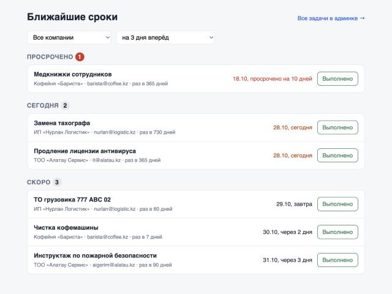
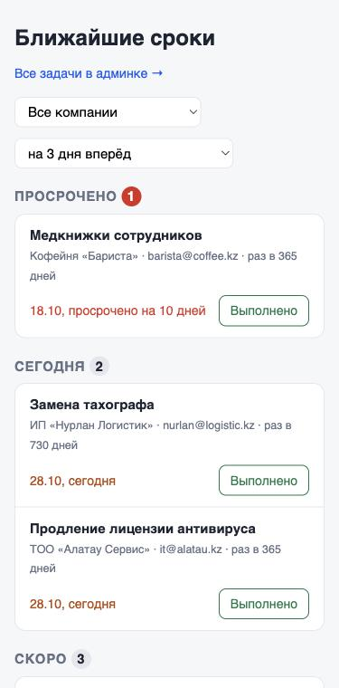

# Напоминания о сроках: Django + Celery

У компании есть регулярные задачи: поверка весов раз в полгода, чистка кофемашины раз в неделю. Каждое утро Celery beat находит задачи, у которых срок в ближайшие 3 дня или уже прошёл, и отправляет каждому ответственному одно письмо со всеми его задачами. Повторный запуск в тот же день второго письма не отправит. Отметка «выполнено» в админке или на странице «Ближайшие сроки» сдвигает срок на один цикл.



## Запуск

```bash
docker compose up --build
```

Поднимутся `db` (Postgres 16), `redis`, `migrate` (миграции и демо-данные), `web` на `localhost:8000`, `celery` и `beat`.

- `localhost:8000` — страница «Ближайшие сроки», вход `admin` / `admin`. Этого пользователя `seed_demo` создаёт, только если задан `DEMO_ADMIN_PASSWORD`, а в compose он задан для демо;
- `localhost:8000/admin/` — компании, задачи, журнал отправленных дайджестов.

Beat запускает рассылку в 09:00 по Алматы (`DIGEST_HOUR`, `DIGEST_MINUTE`). Чтобы не ждать утра:

```bash
docker compose exec web python manage.py send_digests
docker compose logs celery
```

Письма печатаются в лог воркера (console email backend). Так выглядит одно из них на демо-данных:

```
To: nurlan@logistic.kz
Subject: Сроки на 28.10: 2 задачи

Здравствуйте!

Вот что нужно сделать в ближайшие 3 дня.

Сегодня, 28.10.2026:
  - Замена тахографа (ИП «Нурлан Логистик»)

Скоро:
  - ТО грузовика 777 ABC 02 (ИП «Нурлан Логистик») — 29.10.2026, завтра

Когда сделаете, отметьте задачу выполненной, и следующий срок пересчитается сам.
```

Второй запуск `send_digests` в тот же день пишет в лог `digest for nurlan@logistic.kz on 2026-10-28 already sent` и ничего не отправляет.

## Модель

- `Company` — название.
- `Task` — компания, название, `assignee_email`, `cycle_days`, `last_done_on`, `status` (`active` / `paused`) и вычисляемое поле `due_on`.
- `Digest` — журнал: кому, за какую дату, какие задачи вошли. На паре (`email`, `sent_on`) уникальный индекс.

Срок задачи — `last_done_on + cycle_days`. Если задачу ещё ни разу не выполняли, срок наступает в день её создания: раз неизвестно, когда её делали последний раз, лучше напомнить сразу.

`Task.is_due(days_ahead=3, today=None)` возвращает `True` для активной задачи, у которой срок не позже `today + days_ahead`, включая просроченные. `today` по умолчанию — текущая дата в Алматы.

## Тесты

Одной командой, против Postgres:

```bash
docker compose --profile test run --rm --build tests
```

Без Docker: `uv run pytest`. Тогда база SQLite, и один тест, которому нужны настоящие блокировки строк (`test_parallel_runs_send_one_letter`), пропускается.

```
tests/test_digest.py::test_each_assignee_gets_one_letter_with_all_their_tasks PASSED
tests/test_digest.py::test_running_twice_on_the_same_day_sends_nothing_new PASSED
tests/test_digest.py::test_next_day_sends_again PASSED
tests/test_digest.py::test_default_day_is_today_in_almaty PASSED
tests/test_digest.py::test_nothing_due_means_no_letters PASSED
tests/test_digest.py::test_email_case_does_not_split_the_digest PASSED
tests/test_digest.py::test_digest_remembers_what_was_sent PASSED
tests/test_digest.py::test_failed_send_is_not_recorded_so_the_retry_goes_out PASSED
tests/test_digest.py::test_celery_retries_when_the_mail_server_is_unreachable PASSED
tests/test_is_due.py::test_is_due_around_the_boundaries[-30-True] PASSED
tests/test_is_due.py::test_is_due_around_the_boundaries[-1-True] PASSED
tests/test_is_due.py::test_is_due_around_the_boundaries[0-True] PASSED
tests/test_is_due.py::test_is_due_around_the_boundaries[1-True] PASSED
tests/test_is_due.py::test_is_due_around_the_boundaries[3-True] PASSED
tests/test_is_due.py::test_is_due_around_the_boundaries[4-False] PASSED
tests/test_is_due.py::test_is_due_around_the_boundaries[90-False] PASSED
tests/test_is_due.py::test_zero_days_ahead_means_today_and_overdue_only PASSED
tests/test_is_due.py::test_never_done_task_is_due_right_away PASSED
tests/test_is_due.py::test_paused_task_is_never_due PASSED
tests/test_is_due.py::test_database_filter_agrees_with_is_due PASSED
tests/test_is_due.py::test_mark_done_moves_the_deadline_by_one_cycle PASSED
tests/test_is_due.py::test_early_completion_counts_the_cycle_from_the_actual_date PASSED
tests/test_is_due.py::test_editing_the_cycle_recomputes_the_deadline PASSED
tests/test_is_due.py::test_assignee_email_is_normalized PASSED
tests/test_is_due.py::test_today_is_the_local_date_in_almaty PASSED
tests/test_views.py::test_page_needs_login PASSED
tests/test_views.py::test_expired_session_redirects_the_whole_page_on_htmx_requests PASSED
tests/test_views.py::test_full_page_and_fragment_are_cached_separately PASSED
tests/test_views.py::test_done_button_carries_a_working_csrf_token PASSED
tests/test_views.py::test_page_groups_tasks_by_deadline PASSED
tests/test_views.py::test_htmx_request_gets_only_the_board PASSED
tests/test_views.py::test_filters_by_company_and_horizon PASSED
tests/test_views.py::test_garbage_filters_fall_back_to_defaults PASSED
tests/test_views.py::test_done_button_moves_the_task_out_of_the_board PASSED
tests/test_views.py::test_done_needs_post PASSED
tests/test_views.py::test_admin_action_marks_tasks_done PASSED
tests/test_views.py::test_admin_changelist_renders PASSED
tests/test_digest.py::test_parallel_runs_send_one_letter PASSED
============================== 38 passed in 1.73s ==============================
```

Время в тестах заморожено на 02.11.2026 10:00 по Алматы (time-machine), поэтому они не зависят от того, когда их запускают.

## Решения и компромиссы

**Границы.** Окно включает обе стороны: просроченные задачи, сегодняшние и те, у которых срок ровно через 3 дня. Через 4 дня — уже нет. Параметризованный тест проходит по точкам −30, −1, 0, 1, 3, 4, 90 дней. Отдельный тест сверяет `is_due()` с фильтром в базе на 15 задачах подряд, чтобы Python-логика и SQL не разошлись.

**«Сегодня» — это дата в Алматы, а не в UTC.** С 00:00 до 05:00 по Алматы дата в UTC ещё вчерашняя. Если брать `date.today()` на сервере в UTC, ночной или ранний утренний запуск видел бы горизонт на день короче. Везде используется `timezone.localdate()` с `TIME_ZONE = "Asia/Almaty"`, и это проверяет `test_today_is_the_local_date_in_almaty`.

**Срок хранится в поле `due_on`.** Его можно было бы считать в запросе (`last_done_on + cycle_days`), но тогда выборка «срок в ближайшие N дней» не использует индекс, а арифметика с датами в SQL отличается от базы к базе. `due_on` пересчитывается в `save()`, в том числе при `save(update_fields=...)`, и по нему построен индекс. Цена — массовый `queryset.update(cycle_days=...)` обойдёт `save()`, поэтому в админке смена цикла идёт через форму, а отметка — через `mark_done()`.

**Без дублей — уникальный индекс, а не проверка в коде.** Строка `Digest(email, sent_on)` вставляется в той же транзакции, что и отправка письма. Если beat случайно запустили дважды или Celery повторил задачу, второй процесс упрётся в уникальный индекс, дождётся коммита первого и увидит, что письмо уже ушло. `test_parallel_runs_send_one_letter` запускает четыре потока одновременно на Postgres, и письмо уходит ровно одно. Если SMTP упал, транзакция откатывается вместе со строкой, и ретрай Celery (до 5 раз с нарастающей паузой) отправит письмо заново.

**Остаётся at-least-once.** Если письмо ушло, а процесс умер до коммита, ретрай отправит его ещё раз. Совсем исключить это без идемпотентного почтового API нельзя, но окно — миллисекунды между `send_mail` и `COMMIT`.

**Ретраи на любую сетевую ошибку.** `autoretry_for=(OSError,)`: под него попадают и `SMTPException`, и отказ в соединении, и таймаут, и ошибка DNS. Если ловить только `SMTPException`, таймаут подключения к почтовому серверу молча съел бы дайджест за день. Это проверяет `test_celery_retries_when_the_mail_server_is_unreachable`.

**Одна задача Celery на получателя.** Ежедневная задача только собирает адреса и ставит по задаче на каждого. Один сломанный адрес не тормозит остальных, а ретраится отдельно. Дата фиксируется в момент запуска и передаётся в подзадачи, чтобы ретрай после полуночи не превратился в письмо за другой день.

**Email нормализуется.** `Aigerim@Example.kz` и `aigerim@example.kz` — один человек и одно письмо. Адрес приводится к нижнему регистру при сохранении задачи.

**Досрочное выполнение.** Следующий срок считается от фактической даты выполнения, а не от старого срока. Для поверок и ТО так и нужно: если весы поверили на неделю раньше, следующая поверка тоже наступит раньше.

## Страница «Ближайшие сроки» (HTMX)

Три группы: просрочено, сегодня, скоро. htmx лежит в статике проекта, а не грузится с CDN. Фильтры по компании и горизонту (сегодня, 3, 7, 14, 30 дней) перерисовывают только список и пишут параметры в URL (`hx-push-url`), так что ссылку с фильтром можно переслать. Кнопка «Выполнено» отправляет POST с CSRF-токеном, сдвигает срок и возвращает обновлённый список с сообщением «Следующий срок …». Что токен действительно доходит, проверяет тест с `enforce_csrf_checks=True`: обычный тестовый клиент Django CSRF не проверяет. Если сессия истекла, htmx-запрос получает `HX-Redirect` на страницу входа, а не вставляет форму логина внутрь списка. Ответ помечен `Vary: HX-Request`, потому что один и тот же адрес отдаёт то фрагмент, то целую страницу. Вёрстка проверена на ширине 375 px:



## Настройки

`DJANGO_DEBUG` по умолчанию выключен. Без `DJANGO_SECRET_KEY` приложение с выключенным DEBUG не стартует: лучше упасть сразу, чем работать с известным всем ключом. В compose оба значения заданы для локального демо, тесты используют `config/settings_test.py`.

| Переменная | По умолчанию | |
|---|---|---|
| `DJANGO_SECRET_KEY` | обязателен при DEBUG=0 | в compose — локальное значение |
| `DJANGO_DEBUG` | `0` | |
| `DATABASE_URL` | SQLite рядом с проектом | в compose — Postgres |
| `CELERY_BROKER_URL` | `redis://localhost:6379/0` | |
| `REMINDER_DAYS_AHEAD` | `3` | горизонт рассылки |
| `DIGEST_HOUR`, `DIGEST_MINUTE` | `9`, `0` | время рассылки по Алматы |
| `DEMO_ADMIN_PASSWORD` | не задан | если задан, `seed_demo` создаёт пользователя `admin` |

## Структура

```
config/              settings (+ settings_test), celery app, urls
reminders/
  models.py          Company, Task (is_due, mark_done), Digest
  services.py        выборка задач и отправка одного дайджеста
  tasks.py           send_due_digests (beat) → send_digest (на каждого получателя)
  admin.py           действие «Отметить выполненными сегодня», цветная колонка срока
  views.py           страница на HTMX
  management/        seed_demo, send_digests
tests/
```
